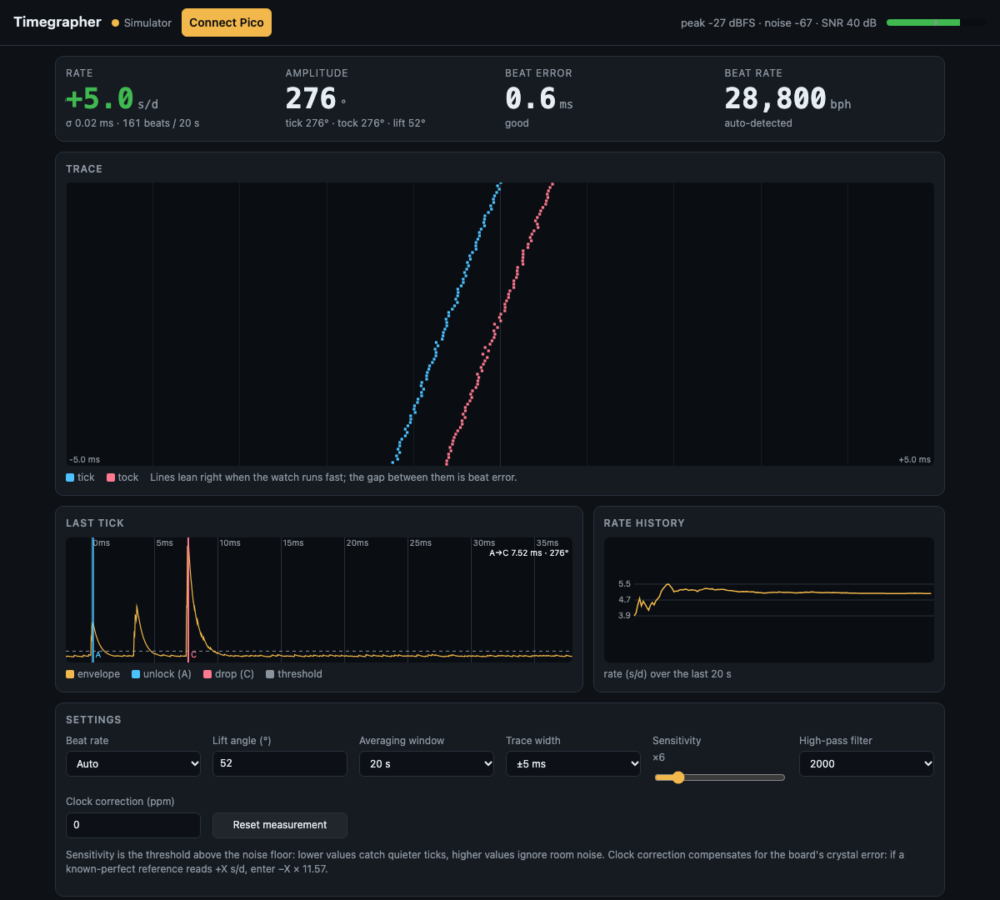

# Pico Timegrapher

A DIY timegrapher for mechanical watches, built from a **Raspberry Pi Pico** and an
**INMP441 I2S microphone** for about $10 in parts. Put a watch on the mic, open a
web page in Chrome, and read:

- **Rate**: how many seconds a day the watch gains or loses
- **Amplitude**: how far the balance wheel swings, in degrees
- **Beat error**: how evenly the tick and the tock are spaced, in milliseconds
- **Beat rate**: detected automatically (12,000–43,200 bph)

It also draws the classic paper-strip trace, the waveform of each tick, rate
history, and a table for comparing readings across positions (dial up, crown
down and so on). It works much like phone apps such as *Watch Accuracy Meter*,
but with a dedicated microphone and a sample clock you can calibrate.



*Screenshot taken in the built-in simulator.*

## How it works, in one picture

```
 watch ─▶ INMP441 ──I2S, 48 kHz──▶ Pico
                                    core 1: filter → envelope → find each tick → timestamp it
                                    core 0: stream ticks over USB
                                              │
                                              ▼
                         web/index.html in Chrome/Edge (Web Serial)
                         detects BPH, fits rate & beat error, measures amplitude, draws
```

The Pico handles the timing-critical part: it timestamps each tick from the
microphone's sample clock, to a fraction of a sample (under 21 µs). The
browser does the maths and the display. The [how it works](docs/how-it-works.md)
doc covers the details.

## Quick start

1. **Wire** the INMP441 to the Pico: SCK→GP2, WS→GP3, SD→GP4, L/R→GND,
   VDD→3V3, GND→GND. See [hardware](docs/hardware.md).
2. **Flash** the firmware. Hold BOOTSEL, plug in the Pico, and copy the `.uf2`
   onto the `RPI-RP2` drive. See [building the firmware](docs/hardware.md#flashing-the-firmware).
3. **Open** `web/index.html` in Chrome or Edge, click **Connect Pico**, and set
   the watch on the microphone. See [using it](docs/usage.md).

There's no app to install and nothing to run on the computer: the page is a
single local HTML file. Open it without a Pico connected and it runs a
**simulator** (a synthetic watch fed through the same detection code), so you
can try everything first.

## Documentation

| Doc | What's in it |
|---|---|
| [Hardware](docs/hardware.md) | Parts, wiring, soldering, mic mounting, flashing |
| [Using it](docs/usage.md) | Taking a reading, what the numbers mean, settings, calibration, troubleshooting |
| [How it works](docs/how-it-works.md) | Signal processing, the rate/beat-error fit, the amplitude formula, accuracy |
| [Development](docs/development.md) | Repo layout, tests, serial protocol, the ESP32 variant |

## Status

- **Working:** the firmware runs on a Pico and streams over USB. The real I2S
  sample rate is measured and corrected for. The analysis passes end-to-end
  tests on synthetic watch audio: rate within about 0.05 s/day, beat error
  within about 0.01 ms, and amplitude within a few degrees, across 18,000–36,000
  bph with missed ticks and noise.
- **Not yet done:** validation against real watches and a reference
  timegrapher. Amplitude in particular depends on how a real tick sounds through
  this microphone, so treat it as approximate until that's done.

## ESP32 variant

`firmware/esp32_timegrapher` runs the same detector on an ESP32. It serves the
page itself over WiFi, so you can use it from a phone. See
[development](docs/development.md#esp32-variant).

## License

MIT, see [LICENSE](LICENSE).
